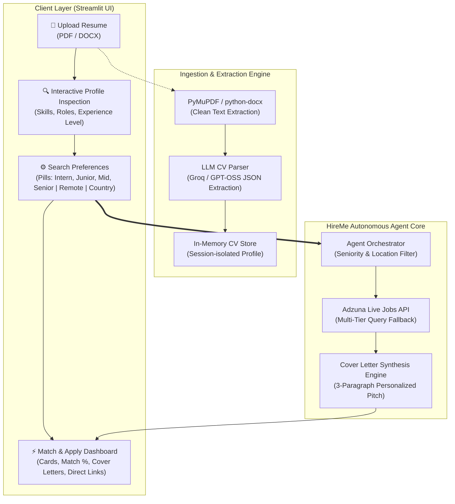
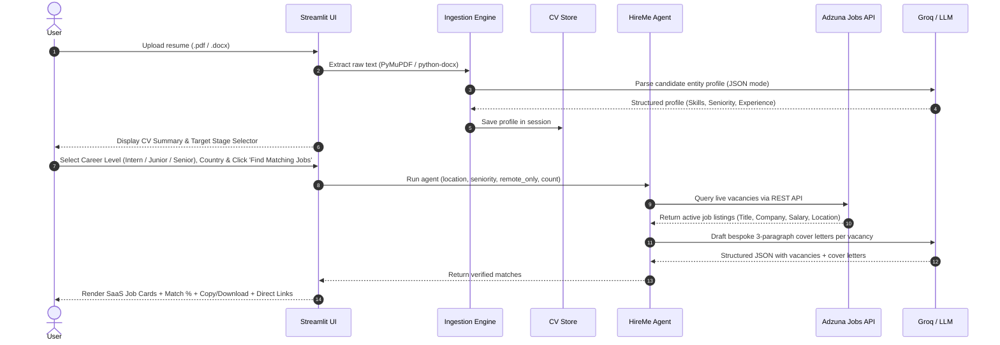

# 💼 HireMe Agent — Autonomous AI Career & Job-Hunting Assistant

[](https://www.python.org/)
[](https://streamlit.io/)
[](https://groq.com/)
[](https://developer.adzuna.com/)
[](https://opensource.org/licenses/MIT)

> **HireMe Agent** is a production-grade, AI-powered career co-pilot that turns a raw resume into live, high-converting job applications. It extracts candidate experience, matches real-time market vacancies, and generates custom 3-paragraph cover letters tailored to the candidate's exact seniority level in under **6 seconds**.

---

## 🚀 Live Demo & Workflow

- **Live Application:** [HireMe Agent on Streamlit Cloud](https://hireme-agent-jvkkgqltr2mrttq8g32qnk.streamlit.app/)
- **Repository:** [github.com/AmirSaad1417/hireme-agent](https://github.com/AmirSaad1417/hireme-agent)

---

## 🏛️ System Architecture



---

## 🔄 Complete Execution Flow



---

## ✨ Key Features

- **Multi-Format Resume Ingestion**: High-fidelity text extraction supporting PDF (`PyMuPDF`) and Word documents (`python-docx`).
- **Deterministic Career Tier Selector**: Choose between `Auto-detect`, `Internship / Student`, `Junior / Fresh`, `Mid-Level`, and `Senior / Lead` without state reset or selection flickering.
- **Real-Time Job Query Engine**: Connects to the **Adzuna Jobs API** with multi-tier fallback querying across 9+ global countries (UK, US, Canada, Germany, India, Australia, etc.).
- **Global Anti-Geoblock Links**: Generates direct Google Jobs and LinkedIn search URLs for every listing, allowing international applicants to apply directly without country restrictions.
- **Sub-6-Second Generation**: Engineered for rapid execution using Groq inference (`openai/gpt-oss-120b`), generating up to 3 comprehensive job pitches and cover letters in ~5.7s.
- **Deterministic Local Match Scoring**: Instant, zero-cost keyword overlap algorithm (68%–98%) evaluating skills and target titles against live job descriptions.
- **Interactive Cover Letter Workspace**: In-app editable textarea, 1-click clipboard copy with visual toast confirmation, `.txt` file export, and shortlist bookmarking.
- **Clean SaaS UI / UX**: Modern, accessible interface with CSS tokens, responsive flex cards, Material/SVG icons, and native Light/Dark theme compatibility.

---

## 📂 Project Structure

```text
hireme_agent/
├── .streamlit/
│   └── config.toml             # Custom theme colors (Soft Blue/Teal & Slate)
├── src/
│   ├── agents/
│   │   ├── __init__.py
│   │   └── hire_agent.py       # Ultra-fast 2-turn agent loop with Groq
│   ├── config/
│   │   ├── __init__.py
│   │   └── settings.py         # Dynamic config loader (Streamlit Secrets + .env)
│   ├── memory/
│   │   ├── __init__.py
│   │   └── cv_store.py         # Thread-safe in-memory CV store
│   ├── parsers/
│   │   ├── __init__.py
│   │   ├── cv_extractor.py     # PDF & DOCX binary text extraction
│   │   └── cv_parser.py        # LLM structured JSON resume parsing
│   ├── tools/
│   │   ├── __init__.py
│   │   ├── job_scraper.py      # Fallback web scraper for job descriptions
│   │   ├── job_search.py       # Adzuna API client with query fallback
│   │   └── tool_registry.py    # OpenAI-compatible function calling schemas
│   └── ui/
│       ├── __init__.py
│       ├── components.py       # Hero banner, stepper, CV preview, SVG icons
│       ├── results_page.py     # Results dashboard, cards, tabs, and export
│       ├── styles.py           # Design system CSS variables & tokens
│       └── upload_page.py      # 3-step guided upload & search interface
├── .env.example                # Clean template for required API keys
├── .gitignore                  # Security-first ignore file (never tracks .env)
├── app.py                      # Main application entry point
├── README.md                   # Comprehensive developer documentation
└── requirements.txt            # Minimal, production-pinned Python packages
```

---

## 🛠️ Local Development Setup

### 1. Prerequisites
- Python 3.10, 3.11, or 3.12
- Git

### 2. Clone the Repository
```bash
git clone https://github.com/AmirSaad1417/hireme-agent.git
cd hireme-agent
```

### 3. Create and Activate Virtual Environment
```bash
# Windows (PowerShell)
python -m venv .venv
.venv\Scripts\Activate.ps1

# macOS / Linux
python3 -m venv .venv
source .venv/bin/activate
```

### 4. Install Dependencies
```bash
pip install --upgrade pip
pip install -r requirements.txt
```

### 5. Configure API Credentials
Copy `.env.example` to `.env`:
```bash
copy .env.example .env     # Windows
cp .env.example .env       # macOS / Linux
```

Edit `.env` with your API keys:
```env
# Fast Groq API Key (https://console.groq.com/keys)
GROQ_API_KEY=gsk_your_actual_groq_api_key

# Adzuna Jobs API (https://developer.adzuna.com/)
ADZUNA_APP_ID=your_adzuna_app_id
ADZUNA_APP_KEY=your_adzuna_app_key
ADZUNA_COUNTRY=gb
```

### 6. Run the Application
```bash
streamlit run app.py
```
Open [http://localhost:8501](http://localhost:8501) in your browser.

---

## 🌐 Production Deployment Guide

### Why Streamlit Community Cloud over Vercel?

| Feature | Streamlit Community Cloud (Recommended) | Vercel Serverless |
| :--- | :--- | :--- |
| **Runtime Architecture** | Persistent Python process with WebSocket support | Ephemeral Serverless functions (stateless) |
| **Execution Timeout** | Unlimited (ideal for agent loops & LLM calls) | 10s – 60s hard timeout (causes 504 errors) |
| **C-Extensions (PyMuPDF)** | Native Linux wheel support | Often exceeds bundle limit or fails build |
| **Cost** | **100% Free** | Free / Pro |
| **Secrets Management** | Native encrypted web dashboard | Environment Variables |

> **Recommendation**: Deploy to **Streamlit Community Cloud** (official, 1-click deploy from GitHub, zero server management).

### Step-by-Step Deployment (Streamlit Community Cloud)

1. Push your repository to GitHub: `https://github.com/AmirSaad1417/hireme-agent`.
2. Navigate to [share.streamlit.io](https://share.streamlit.io/) and log in with your GitHub account.
3. Click **"New app"** and select:
   - **Repository:** `AmirSaad1417/hireme-agent`
   - **Branch:** `main`
   - **Main file path:** `app.py`
4. Expand **"Advanced settings..."** and paste your secrets under **Secrets**:
   ```toml
   GROQ_API_KEY = "gsk_your_actual_groq_key"
   ADZUNA_APP_ID = "your_adzuna_app_id"
   ADZUNA_APP_KEY = "your_adzuna_app_key"
   ADZUNA_COUNTRY = "gb"
   ```
5. Click **"Deploy!"**. Your live application will be live at `https://hireme-agent.streamlit.app` in under 2 minutes!

---

## 🔑 Environment Variables Reference

| Variable | Required | Description | Example / Default |
| :--- | :---: | :--- | :--- |
| `GROQ_API_KEY` | **Yes** | Groq API key powering `openai/gpt-oss-120b` | `gsk_...` |
| `ADZUNA_APP_ID` | **Yes** | Adzuna Developer Application ID | `70ccbf1c` |
| `ADZUNA_APP_KEY`| **Yes** | Adzuna Developer Application Key | `243aac...` |
| `ADZUNA_COUNTRY`| Optional | Default country code for job queries | `gb` (or `us`, `ca`, `de`, `in`) |
| `OPENAI_API_KEY`| Optional | Fallback OpenAI API key (if Groq is not used) | `sk-...` |

---

## 🛡️ Security & Privacy

- **Zero Secret Leakage**: The repository's `.gitignore` completely excludes `.env`, `secrets.toml`, and all cache directories.
- **In-Memory Volatility**: Uploaded CV text and parsed JSON profiles are stored strictly in memory for the active user session and are never written to disk or third-party databases.
- **Direct Link Bypasses**: Application links route through Google and LinkedIn search endpoints to prevent regional IP blocking.

---

## 👨‍💻 Author

- **GitHub:** [@AmirSaad1417](https://github.com/AmirSaad1417)
- **Email:** [saadkhan1417@gmail.com](mailto:saadkhan1417@gmail.com)
- **Project Repository:** [https://github.com/AmirSaad1417/hireme-agent](https://github.com/AmirSaad1417/hireme-agent)

---

## 📄 License

This project is licensed under the [MIT License](LICENSE).
